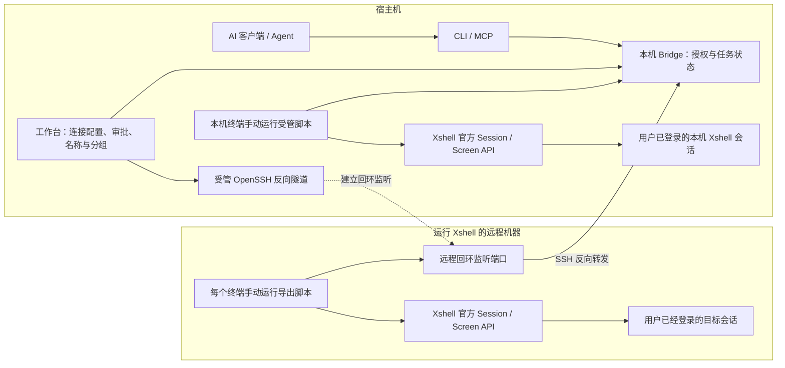

# 架构与协议

[返回总入口](../README.md)

## 组件关系

宿主机工作台维护本地 Bridge 和审批。本机 Xshell 中每个终端手动运行工作台生成的受管 JScript，直接访问数字回环 Bridge；远程 Xshell 则使用导出的脚本，经远端回环转发访问宿主机 Bridge。工作台只在用户显式操作时管理固定参数的反向 SSH 进程。脚本只使用官方 Session/Screen API 操作终端，输出通过私有日志 helper 采集。CLI 与 MCP 使用相同 client 角色、目标检查及任务状态机；危险拒绝策略先于所有授权，命中后操作员也不能批准；不确定脚本则逐次人工审批。只有宿主机操作员可以人工批准、激活或切换默认包；已启用的默认规则由 Bridge 在同一状态机中匹配，未命中已有授权时等待人工。

远程机器不运行 Bridge 后台或审批桌面。OpenSSH 只承载脚本访问宿主机服务的通道，不负责登录目标服务器。终端断开或脚本停止后，需要用户重新运行脚本并核对新接入；不自动恢复任务。

脚本的来源限定令牌只允许该来源的 agent 路由，不授予审批权限。目标以 session ID、接入 generation 和指纹绑定；名称和分组仅是展示与解析元数据。代次变化、重启、结果不明时不自动重放。真实 Xshell 与模拟测试分别验收。

适用于当前 0.8.9 实现；协议号 1 与程序版本、默认规则包版本分别管理。

## 角色与身份

client、agent、admin 使用独立 bearer token。Bridge 监听宿主机回环，远程 agent 经用户在桌面显式建立的 SSH -R 访问。客户端拒绝重定向及非回环明文地址；含 Origin 请求被拒绝，不开放 CORS。令牌不写入审计或返回值。client/CLI/MCP 无管理审批权限。

默认 MCP 使用[共享 HTTP 服务](#桌面退出与共享-mcp)，不创建每对话常驻进程。以下生命周期探测仅适用于兼容保留的 stdio 模式：使用当前 client 的 transport 和凭据只读请求 `GET /v1/health`，要求成功响应的 `protocol` 为 1 且 `version` 为非空字符串。约每 5 秒探测，单次超时 3 秒。曾成功观察健康后，从首次探测失败开始连续 30 秒未观察到恢复则退出，观察到恢复健康重置计时；从未成功观察健康时继续等待启动。空闲不触发退出，认证失败、响应无效及网络错误均不能续命。此观察不提交或重放任务，MCP 退出不表示远端任务停止；一次性 CLI 命令不增加常驻进程。

工作台生成的本机脚本和导出的远程脚本使用 SourceID 限定派生令牌，只能认证并路由自身来源的 agent 操作，无 client/admin 或审批权限，不包含 root/master 令牌。SourceID 不替代 session ID/generation。本机脚本直接访问数字回环 Bridge；远程脚本经 SSH 反向转发访问。名称和分组由宿主机工作台管理。删除连接 profile 不撤销派生令牌，断开仅停止传输；轮换宿主机 master 使全部派生令牌失效，须重新生成或导出，脚本文件按凭据保密。

会话为 `pending → active → detached/expired/blocked`；心跳超过 15 秒失效。注册产生 ID/generation，相同 instance 重试不复活旧接入；同指纹不可同时注册两个有效实例。指纹表示 Xshell 端点信息，不证明最终跳转主机。

新接入带持久化 UTC `created_at`，仅创建记录时赋值；相同 instance 重试、心跳、改名、归档及重启均不改变它，也不纳入指纹、路由或审批签名。历史记录缺失此字段时不补造时间。工作台按创建时间倒序、相同时间按 ID 升序排列；旧记录回退到 `last_seen`，无有效时间的记录排最后。Store、CLI/MCP 会话顺序仍按 ID。

逐终端手动接入：每个终端运行一次脚本，日志使用可打印文本（来源配置决定编码）；身份变化撤销接入。

## 名称与解析

`session_labels` 能力表示可用 admin session-label 编辑匹配代次且心跳有效的 pending/active 名称和 environment；client/agent 不可编辑。名称非空，两项各不超过 200 UTF-8 字节、禁止控制字符。名称按完整指纹保存，不改 Xshell TabText、不改变权限，允许重名。auto_name 仅命名，不代表自动发现或激活。

CLI/MCP resolve 只读当前 active 快照：默认精确、区分大小写，查询去首尾空白；environment 始终精确过滤。显式 CLI `--fuzzy` / MCP `fuzzy:true` 仅在零精确匹配、名称至少两 rune 时做小写名称子串发现，不匹配环境近似项或旧名别名。

返回 matched/ambiguous/suggestions/not_found；仅唯一精确 matched 不要求选择且 CLI 退出 0，其余退出 2、不执行。suggestions 即使唯一也须用户选择；参数/请求错误退出 1。执行始终绑定 ID/generation，任务内复用已选身份并刷新绑定，重连代次改变须重核。名称/分组是不可信元数据。

## 任务与授权

主状态：`pending → queued → dispatched → running → completed`；分支终态 denied/cancelled/unknown。pending/queued 可取消；运行中 interrupt 只请求一次 Ctrl+C，不保证远端停止。

- `(session_id, request_id)` 唯一；所有 Submit 字段相同返回原任务，不同内容冲突。首次提交要求有效 active 和 generation。
- 单次批准针对不可变任务；精确授权固定 30 分钟，匹配 ID/generation/command/cwd/timeout_ms，命中新任务 queued 带 grant_id。
- 操作员参数规则限定 active ID/generation、精确 cwd、程序字面量、固定参数数及逐项完整锚定 RE2；命中 queued 带 rule_id。maxTimeout 为 1000–3600000 ms，minutes 为 1–480；最多 16 参数模式，每项最多 256 字节，最多 100 条有效规则。
- 自定义参数规则的程序名限 `[A-Za-z0-9_][A-Za-z0-9_.-]*`。命令 token 仅 ASCII 字母数字及 `_./:@%+,=-`，空格/tab 分隔；不是 Shell 解析器。引号、换行、Shell 元字符及非 ASCII 不匹配自定义参数规则。默认 v5 包使用独立的有限字面解析器，见[审批规则](approval-policy.md)；先检查危险拒绝与脚本逐次审批要求；其余默认包、精确授权和参数规则均未命中时转人工。没有前缀批准或模型分类器。
- 创建规则不批准已有 pending。撤销使相关未派发 queued 回 pending；派发前重查有效性，失效则回 pending。重启、断开和接入失效清除授权/规则；名称编辑不改变权限。
- 每会话最多一个 dispatched/running；状态先落盘再返回命令，派发响应丢失不重发。Bridge 重启后旧会话 detached，已派发任务 unknown，待执行任务 cancelled。
- 输出 seq 递增，相同最后序号及内容可重试，冲突拒绝。心跳过期或执行期限加 5 秒仍未结束，结果 unknown；不自动杀进程或重放。

任务命令在独立 `sh -c` 的子 shell 内执行，stdin 为 `/dev/null`，仅该子 shell 固定导出 `PAGER=cat`、`SYSTEMD_PAGER=cat`、`SYSTEMD_PAGERSECURE=1`、`SYSTEMD_COLORS=0`、`GIT_PAGER=cat`，不修改交互 shell 环境或审批中的原命令。仍应显式使用工具的非交互选项：所有 systemctl/journalctl 读取加 `--no-pager`，日志限制范围；显式运行 `more`/`less` 不会自动退出。BEGIN/END/DONE 和退出码语义不变；超时或采集失效仍为 unknown，不能据此断言已完成或未执行，也不能重放。

正式 agent 使用[任务日志捕获](log-capture.md)，不读取屏幕行列。helper 先保留私有目录并检查预期文件不存在，StartLog 后仅绑定精确路径及验证过的文件身份，随后才能发送；不接受编号路径。DONE 触发 StopLog 与持有句柄的最终排空；完整解码后的 UTF-8 和完整 END/退出码经最终解析后才能上报完成。传输结果不明不自动重试，失败保留已确认输出并尽力报告一次 unknown。用户已有日志在发送前拒绝；捕获支持无时间戳/ANSI 的可打印文本，编码按来源配置。

## 审批解释、模板与批量决定

### 只读解释

`POST /v1/explain` 允许 client/admin，禁止 agent；client 可解释但不可批量审批。`ExplainRequest` 为 `{session_id,generation,command,cwd,timeout_ms}`，timeout_ms 默认 60000（60 秒）。解释不创建或修改 job、授权、规则或审计记录；目标阻断或 Bridge stopping 时返回相应阻断解释。decision 枚举为 `blocked`、`manual`、`builtin`、`grant`、`rule`；先检查目标阻断和危险策略；危险返回 blocked/command_denied，需逐次审批返回 manual/exact_approval_required，其余匹配默认包、精确授权及有界参数规则。`checks` 提供逐候选的 `reason_code` 和中文 message，参数 index 从 0 开始。

解释仅预测当前新提交，不批准已有 pending，也不重建历史任务的审批来源。CLI：`explain <id> --generation G [--cwd D] [--timeout-ms N] [--command-file file] -- command`，输出 JSON；有效解释（包括需人工审批或 blocked）退出 0，错误退出 1。MCP `explain_command` 标记 `readOnlyHint:true`，不提供 admin 批量工具。用于说明为何需要审批，不要求每次 exec 前调用，不得改写命令规避审批。已有任务仍优先 `wait_job` 跟踪原 ID，无需聊天确认。

### 操作员规则模板

六个模板的命令严格为：`hostname`、`uptime`、`free -h`、`df -h`、`uname -sr`、`ps -eo pid,comm,pcpu,pmem --sort=-pcpu`。下拉选择后须显式点击“套用模板”，才填入程序、字面量参数模式、规则名称、cwd `/`、15 秒 timeout 和 30 分钟有效期；保留用户已选目标。不自动创建规则、批准或执行，仍须正常操作员预览确认。

模板不是安全或只读保证：PATH 与远端环境会影响实际程序和行为，操作员须核查。

### 人工批量决定

仅操作员桌面可选择当前 pending 的 1–20 项；原生端构造的批量作用域 payload 序列化后最多 120 KiB，此限制不指包含丰富会话信息的整个显示快照。卡片展示所选目标和完整命令；有选中项被筛选隐藏时禁止整批操作，新到任务不自动选中。点击决定不再弹出第二次确认；固定 IPC 携带显示快照与连接上下文，绑定任务 ID、session ID、generation、fingerprint、name、environment（分组）、command、cwd、timeout_ms。

原生端内部两次读取新快照并与显示内容复核，服务端在同一 Store 锁内对全部项目原子预检；任一变化则全部保持原状，不把失败项目改为 denied。只发送一次 admin POST；结果未知绝不自动重试，按原 job ID 查询状态。

`POST /v1/admin/decide-batch` 请求：`{allow:bool,items:[{id,session_id,generation,fingerprint,name,environment,command,cwd,timeout_ms}],remember_minutes?:30}`。`allow` 必填；记住授权仅允许单个 allow 项，决定与精确授权一次持久化，多项批准不创建授权或规则。拒绝保留单条拒绝既有的匹配授权/规则撤销语义，相关未选中的 queued 也可能回 pending；已派发任务不会因此停止。批量批准不表示命令已完成，不改变会话间排队与单会话串行执行语义。

## 只读有界等待

CLI：`job wait <id> [--wait-ms N]`；MCP：`wait_job`，参数 `id` 必填，`wait_ms` 可选。等待毫秒数默认 30000，范围 1–30000；非法值报错，不截断。此功能为客户端轮询，服务端端点不变。

立即查询一次，后续每次查询结束后间隔 1 秒 GET 已有 job；completed、denied、cancelled、unknown 均为等待终态。终态返回 `{job,terminal:true,timed_out:false}`；期限到达且已有成功查询时返回 `{job,terminal:false,timed_out:true}`，job 为最新快照；尚无成功查询则报错。等待期限不是远端执行期限，也不将任务改为 unknown。

HTTP 错误或调用取消立即停止等待；取消等待不取消远端任务。不提交 exec、不审批、不 interrupt、不 cancel、返回快照时清空 output 字段，终端输出另行分页读取。CLI 终态退出 0、等待超时退出 2、错误退出 1；远端 exit_code 留在 JSON 中，不映射为等待进程退出码。输出仍使用 job output / read_output 的游标分页。

Skill 在当前活跃回合优先有界等待同一 ID；get_job 用于单次查询。无需聊天确认，不自动重提，不承诺后台无限等待。

## 接口与限额

### 终端记录归档

health 的 `session_removal:true` 表示支持管理员清理。`POST /v1/admin/remove-sessions` 请求为 `{stop_active:bool,items:[{id,generation,state,fingerprint,name,environment,jobs:[{id,status}]}]}`；`stop_active` 必填、jobs 必须为完整数组（无历史时 `[]`）。1–100 个唯一记录；`stop_active:true` 仅允许单个记录。默认仅接受 detached/blocked/expired；显式单个停止移除可接受 active/pending。任一 pending/queued/dispatched/running 任务阻止操作，任何身份或完整任务快照变化均整批拒绝。成功后持久化 `archived:true`，保留 jobs、审计和 labels；单个活动接入同时 detached。重复执行返回冲突，不表示新操作成功。

`GET /v1/sessions` 始终隐藏归档记录，包括附加查询参数时。仅 admin 可用 `GET /v1/admin/sessions?include_archived=true` 读取完整历史身份；此投影供桌面任务详情使用，不是命令目标发现入口。清理端点不供普通 client/agent 或 MCP 使用。原生 IPC 仅增加 `sessionRemovalPrepare`（`action:remove,target` 或 `action:cleanup`）和只接受票据的 `sessionRemovalConfirm`，沿用连接上下文、过期、取消和单次消耗机制。操作流程见[终端清理](maintenance.md#清理终端记录)。

预览使用原生后端两分钟、绑定连接上下文、单次消耗的独立确认票据。确认仅使用预览时的 ID、代次、状态、身份和完整任务状态快照；Store 在同一锁内复核全部成员。任一目标或任务变化、重复 ID、空批次或存储失败均不产生部分移除，也不会刷新为新候选。后来出现的离线记录须另行预览。确认结果未知时只刷新列表或查询原任务，不自动重试。

### 通用接口限额

client/admin 可使用 health、sessions、jobs、job、output、interrupt、detach、audit；提交字段为 session_id、generation、request_id、command、cwd、timeout_ms。admin 执行激活、决定、授权/规则管理、名称编辑及受维护条件约束的 shutdown；agent 仅访问注册、心跳、撤销、poll 和 event。CLI/MCP 不提供管理批准工具。

POST 严格解码，拒绝未知字段和多个 JSON 文档，正文上限 128 KiB。批量 heartbeat 最多 512 成员且受字节上限约束，全部验证后才续租，不派发任务。agent detach 要求 id/generation/fingerprint。命令最多 16 KiB，timeout 1 秒至 1 小时；单事件输出最多 32 KiB，任务输出最多 1 MiB；output 每次最多 16 KiB 完整 UTF-8 片段并返回字节游标。

原生 IPC 队列拒绝超过截止期限且尚未发送的请求。更新 shutdown 原子检查无 active/pending 接入、无在途任务并建立写屏障，不能用普通窗口关闭替代。Bridge、桌面与 CLI 须来自同一便携包，不绕过维护检查。

## 捕获与持久化

原始批准命令经标准转义交给 `sh -c` 子 Shell，stdin=/dev/null；随机 BEGIN/END 标记分段输出，END 含退出码，DONE 用于等待日志结束。正式 agent 通过私有 helper 读取经身份校验的日志文件，不使用 Screen.Get 或屏幕行列捕获。Synchronous、WaitForStrings 仅用于匹配 DONE 哨兵；停止自有日志后最终排空并严格解码，完整 END 和退出码验证通过才确认完成。输出仍是合并的终端转录文本，不是独立的原始 stdout/stderr。实际文件共享、编码和最终刷新时机需真实 Xshell 验收，配置及限额见[日志采集](log-capture.md)。

私有 JSON 快照经临时写入、Sync 和原子替换保存；写盘失败不确认派发。持久 `.bridge-owner.lock` 系统锁防同目录多服务，不删除该文件；获得系统锁且系统检查确认 `bridge.lock` 原始 PID 已退出时，自动将旧标记归档为唯一 `bridge.lock.stale-*` 后启动。PID 存活、标记异常或无法确认退出时保留原标记并拒绝启动，须人工核查，不按时间判旧、不强杀。启动器通过当前配置认证健康检查后尝试打开桌面；桌面继续核对单实例锁、Bridge 进程身份及退出能力，不能仅凭健康检查接管其他包的进程。占用端口但认证失败时报告冲突，不动原进程。真实 Bridge 重启后须手动重新接入并核对身份，维持 no_replay，不恢复旧授权或重放任务。Windows ACL 限定当前用户及 SYSTEM；单用户实现不提供防篡改审计或同账号恶意进程隔离，也不宣称外部终端严格 exactly-once。

## 默认策略与显示快照决定

健康握手增加严格布尔能力 `builtin_policy`、`displayed_approval`。`GET /v1/policy` 返回可比较快照 `{id:"builtin-readonly-v5",version:5,enabled:true,revision:N}`；`GET /v1/command-policy` 向 client/admin 返回该快照、分类示例和限制，agent 不可访问，其他方法不能修改规则。`read_limits.numeric_maximum=1000000` 仍用于行数/上下文计数，新增 `byte_maximum=67108864` 用于 head/tail 字节参数；有限 timeout 约束列于 constraints。CLI `policy show` 和 MCP `get_command_policy` 只读访问同一目录；目录不执行、不授权，也不保证目标或规则之后不变。`POST /v1/admin/policy` 接收 `{expected:<完整原状态>,enabled:<显式布尔>}`，锁内比较后持久化，只允许 admin。设置不存在时默认启用，明确 false 持久保存。

现有 `POST /v1/admin/decide-batch` 原子比较完整 BatchItem；新增可选 `remember_minutes:30`，仅单个 allow 项有效，写入决定与精确 grant 为同一次持久化。新原生固定 IPC `displayedDecide` 接收 action、完整显示 items（job/session）和 remember；内部两次捕获核对再调用此原子接口，无任意管理路径参数。`builtinPolicySet` 比较完整显示包状态再发起版本化 CAS。

仲裁、未命中原因、命令完整表及审批行为见[审批策略](approval-policy.md)。新增任务来源 `builtin_rule_id`、`approval_source`、追加式 `approval_history`；解释当前匹配不覆盖历史。两入口仍共用 Store.Submit，不补批、不重放。

原生端只有在确知决定未发送时返回 `DECISION_NOT_SENT`；工作台刷新后可重新核对卡片，不自动重复操作。POST 已尝试或响应丢失时不带此码，原任务保持只查询。成功显示页面提示并刷新列表，不弹出结果窗口。

原生 snapshot 附带不透明 `approval_context`（本原生实例与连接上下文的摘要），一键决定和规则包开关必须原样携带显示快照中的 context。其他实例或过期上下文在任何网络读取前拒绝。它不替代操作员角色或服务端目标校验；旧上下文响应不会用于新界面。

## 脚本导出确认

远程脚本导出以固定顺序的配置字段和文件哈希构造快照，避免 JSON 字段排列导致误报。确认先消耗票据，再复核最终路径、ACL、配对、配置及程序包内容；实际配置、源文件或目标变化会使确认失效。取消保存框不准备或写入文件，导出失败不自动重试或覆盖目标。诊断阶段与处理见[导出故障](maintenance.md#远程脚本导出故障)。

### 桌面退出与共享 MCP

`GET /v1/health` 返回当前 `bridge_pid`，可用时声明 `desktop_shutdown=true`、`mcp_http=true`。桌面先持有进程句柄，再核对认证健康响应 PID、运行目录锁标记及包内程序路径，绑定非继承 Windows Job Object；同运行目录以独占文件句柄限制单一桌面，句柄随进程退出释放，不通过删除锁抢占。

`POST /v1/admin/desktop-shutdown` 只接受 admin 与空对象 `{}`。锁内撤销活动接入与授权，将 pending/queued 置 cancelled、dispatched/running 置 unknown，保留历史结果，持久化后建立写屏障并触发服务退出。失败回滚，重复请求拒绝。旧 `/v1/admin/shutdown` 的空闲检查保持不变，仅用于更新交接等维护流程；CLI/MCP 不增加管理停机工具。

`/mcp` 在同一个回环监听器内提供无状态 Streamable HTTP，仅允许 client/admin 凭据、拒绝浏览器 Origin 和 agent 凭据。它复用既有 MCP 工具集，调用同一 client API，继续由 Bridge 仲裁目标、审批、任务状态和重复 request_id；不增加旁路，也不复用目标身份或自动重试命令。单次 HTTP 写超时 40 秒覆盖最多 30 秒的 wait_job。

### 危险策略接口结果

`/v1/command-policy` 新增 `hard_deny`（id、enabled、categories、notice），固定启用且不受只读包开关影响。明确危险的新提交返回 HTTP 403，JSON 错误码 `COMMAND_DENIED`，不创建 job。脚本/无法静态检查的任务返回 pending，`requires_exact_approval=true`；批准一次仍可用，记住请求返回 `EXACT_APPROVAL_REQUIRED`。单条、批量批准与派发再次校验；派发前危险任务转 denied，reason 以 COMMAND_DENIED 开头，审计 action 为 policy_deny。完整范围和分析限制见[审批策略](approval-policy.md)。
